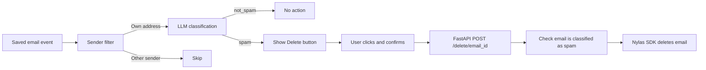

# Week 3: A Simple Spam Workflow

## This Week's Goals

1. **Build a spam workflow:** Take the emails you captured in Week 2, parse them with Pydantic, keep only emails sent from your own address, classify each one as spam or not spam with an LLM, and delete spam through Nylas after you confirm.
2. **Understand FastAPI:** Learn how FastAPI receives requests, validates data with Pydantic, and returns responses. Practice these concepts in the [FastAPI tutorial](week3/fastapi-tutorial/README.md).

> **My notes – success criteria (from the slides):**
> - [ ] Capture 3 email events as JSON and validate one with Pydantic
> - [ ] Filter your own sender, classify with a confidence score, confirm the deletion
> - [ ] Complete the FastAPI tutorial and send a test request
>
> The slides frame spam only as the example. The actual task is **“build beyond spam”**: choose what your assistant should do (e.g. draft replies, download attachments) and keep a user confirmation before every consequential action.

## Before You Start: Recap Week 2

This week builds on the email capture setup from [Week 2](https://github.com/lindseypeng/ai-personal-assistant/blob/week-2/README.md). Make sure you can still capture emails with Nylas:

1. **Restart the Serveo tunnel.** Serveo only runs temporarily, so you need a new tunnel each session.
2. **Start `main.py`:** `cd app` then `uv run main.py`.
3. **Check the webhook.** If the tunnel URL changed, delete the old webhook in the Nylas Dashboard, update `SERVER_URL`, create a new webhook, and restart `main.py` to load the new secret. See [Start a New Session](docs/start-new-session.md) for each step.
4. **Send yourself 2 to 3 sample spam emails** from the address in `EMAIL`. Check that each one is saved as JSON in `requests/events/`.
5. **Follow this week's slides** to build the workflow step by step.

If emails stop arriving, see the [Webhook Troubleshooting Guide](docs/webhook-troubleshoot-guide.md).

> **My notes – Steps 1–4 in detail (slides: “Step A: Data first”)**
>
> You need three terminals, all in the repo root. Why the order matters: Nylas sends a test request to your URL when the webhook is created, so `main.py` must already be running. And `main.py` reads `.env` only at startup, so it needs a restart after you paste the new secret.
>
> **1. Tunnel (terminal 1)**
> ```bash
> ssh -o ServerAliveInterval=30 -o ServerAliveCountMax=3 -R 80:localhost:8000 serveo.net
> ```
> Note the `https://…` URL that Serveo prints. Keep this terminal open.
>
> **2. Compare with `.env`**
> ```bash
> grep SERVER_URL .env
> ```
> - **Same URL:** the old webhook still works. Do step 5 (start `main.py`), then go straight to step 8. No new webhook, no restart.
> - **Different URL:** the old webhook points to a dead address. Continue with step 3.
>
> **3. Delete the old webhook in the Nylas Dashboard**
> 1. Open the Nylas Dashboard in the browser (`https://dashboard-v3.nylas.com`) and log in.
> 2. Select your application (the one whose Client ID is `NYLAS_CLIENT_ID` in `.env`).
> 3. Open **Notifications** in the menu. It lists your webhooks.
> 4. Find the entry whose URL is your *old* `SERVER_URL` + `/events` (description: “Message Created Webhook”).
> 5. Delete it. If several old entries exist, delete all of them.
>
> Why: the old webhook keeps its dead URL and shows a failing status. One webhook per tunnel URL keeps it clear which secret in `.env` belongs to which webhook.
> *Unverified:* the exact button labels in the dashboard. The repo docs only name the **Notifications** section.
>
> **4. Update `.env`**
> - `SERVER_URL=` the new tunnel URL, **without** a trailing `/` and **without** `/events` (`config_webhook.py` appends `/events` itself)
> - `WEBHOOK_SECRET=` leave it empty for now
>
> If you ever ran `export SERVER_URL=…` in a terminal, open a new one: `load_dotenv()` does not override variables that are already set.
>
> **5. Start `main.py` (terminal 2)**
> ```bash
> cd app && uv run main.py
> ```
> Start it from `app/`, otherwise `TemplateNotFound`.
>
> **6. Create the webhook (terminal 3)**, only if the URL changed
> ```bash
> cd app/config && uv run config_webhook.py
> ```
> The output has several lines. **Only the last line is the secret.** Copy it into `WEBHOOK_SECRET=` in `.env`. (The `id` from the output gives `401`.)
> If you get `unable.verify.webhook_url`: `main.py` (step 5) or the tunnel (step 1) is not running.
>
> **7. Restart `main.py` (terminal 2)**
> Press `Ctrl+C`, then run `uv run main.py` again. This loads the new secret.
>
> **8. Test**
> Send yourself an email from the address in `EMAIL`. Terminal 2 should show `POST /events … 200`, and a new `.json` file appears in `requests/events/`. A `401` instead means the secret in `.env` does not match (see step 6).

## Week 3 Workflow

FastAPI receives the Nylas webhook at `POST /events`, saves the event as JSON, and starts a background spam check. The diagram below shows what happens after capture.



In the web app, the Delete button asks for confirmation before submitting to FastAPI. The endpoint checks that the email is already classified as spam, then calls the Nylas SDK. Nylas itself does not require a user click. The confirmation comes from our application. Protect the delete endpoint before running the app long term.

The sender filter only lets through emails from your own address. While you are learning, this keeps the workflow on test emails you control, so a wrong classification can never delete a real email from someone else.

> **My notes – where each step lives in the code (slides, Steps B–F)**
>
> | Step | What happens | Code |
> |---|---|---|
> | Capture | `POST /events` checks the signature and saves the raw event | `app/main.py`: `webhook()`, `store_event_json()` |
> | B Parse | Read the saved JSON; `WebhookEvent` validates the envelope, `EmailObject` the email in `data.object` | `spam_workflow.py`: `load_email()`; `app/schemas/nylas_{webhook,email}_schema.py` |
> | C Filter | Compare the sender with `EMAIL` in `.env` (a testing guard, not a feature) | `spam_workflow.py`: `is_from_me()`; `main.py`: `check_spam()` |
> | D Classify | Structured output: `EmailCategory` (spam / not_spam) + `confidence` 0–1 as a Pydantic model, same technique as Week 2 `structured_output` | `spam_workflow.py`: `EmailCategory`, `Classification`, `classify()` |
> | E Confirm | Delete button only for spam; the browser asks for confirmation, then submits `POST /delete/{email_id}` | `app/templates/index.html` (form `onsubmit`); `main.py`: `delete()` |
> | F Delete | `delete()` checks the email is classified as spam, then `nylas.messages.destroy(identifier=email.grant_id, message_id=email.id)` | `main.py`: `delete()`; `spam_workflow.py`: `delete_email()` |
>
> **Known limits (slides):**
> - Classification results live in memory (`webhooks`, `classifications` in `main.py`) and are gone after a restart.
> - `POST /delete/{email_id}` has no authentication and no CSRF protection, and the tunnel makes it publicly reachable. Damage is limited because only emails classified as spam *and* sent from `EMAIL` can be deleted. Only use your own test emails and don't share the tunnel URL. Part 2 (Bearer token) shows how to protect an endpoint.
> - Next week: vector database and RAG over the stored email events.

## Part 1: Run the Spam Workflow

The workflow lives in `app/workflows/spam_workflow.py`. It needs `OPENAI_API_KEY` in `.env`.

> **My notes – GWDG instead of OpenAI:** In this fork `classify()` uses GWDG Chat AI (Academic Cloud), so no `OPENAI_API_KEY` is needed. It needs `ACADEMIC_CLOUD_API_KEY` (in the shell or `.env`) and optionally `GWDG_MODEL` (default `qwen3-30b-a3b-instruct-2507`). Only the client changes (`base_url`, `api_key`, `model`); `responses.parse(..., text_format=Classification)` works the same, see `week2/gwdg_structured_output.py`.

**In the browser:** With `main.py` and the tunnel running, send yourself a spam email and refresh `http://localhost:8000`. Emails classified as spam show a Delete button.

**From the terminal:** Run the workflow on one saved event. Use a file name from `requests/events/` without `.json`:

```bash
uv run app/workflows/spam_workflow.py <event_id>
```

The script prints the category and confidence, then asks before it deletes anything.

## Part 2: Practice FastAPI

The `week3/fastapi-tutorial/` folder is a small standalone FastAPI app. It covers routers, Pydantic request validation, GET vs POST, sync vs async endpoints, and Bearer token authentication.

Stop `app/main.py` first, since both apps use port 8000. Then run:

```bash
cd week3/fastapi-tutorial
uv run uvicorn main:app --reload
```

Open `http://localhost:8000/docs` to try the endpoint, or run `uv run request.py` from the same folder in another terminal. See the [FastAPI tutorial README](week3/fastapi-tutorial/README.md) for the full walkthrough.
